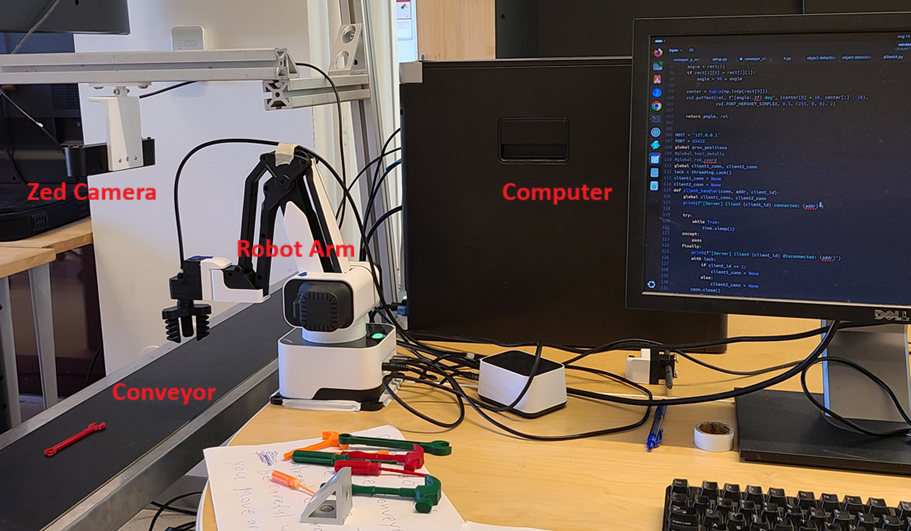

# AI-Enabled Multi-Task Robot Work-Cell

An integrated robotic workcell combining computer vision, stereo-depth
perception, and robot control for conveyor-based tool picking.

## Project Overview

This project integrates a Rotrics DexArm, a ZED stereo camera, and
YOLOv8-based object detection to identify tools and coordinate robotic
picking operations.

The perception pipeline characterizes detected objects, estimates their
position and orientation, and transforms camera measurements into
robot-control coordinates. Grasp-verification and retry logic support
recovery from unsuccessful pick attempts.

## My Contributions

- Developed the Python perception and robot-control implementation.
- Integrated YOLOv8 detection for hammer, wrench, and screwdriver classes.
- Implemented stereo-depth-based object position estimation.
- Developed object orientation, size, and color characterization workflows.
- Implemented coordinate transformations and grasp alignment.
- Integrated socket communication between perception and control components.
- Developed grasp-verification and retry logic.
- Tested and refined the integrated workcell.

## System Workflow

1. Acquire camera images and depth information.
2. Detect and classify tools using YOLOv8.
3. Estimate object position, orientation, and relevant characteristics.
4. Transform the target into robot-control coordinates.
5. Execute the picking sequence.
6. Check the grasp outcome and retry when required.

## Technologies and Hardware

**Software:** Python, Linux, YOLOv8, OpenCV, ZED SDK, socket communication

**Hardware:** Rotrics DexArm, ZED stereo camera, conveyor,
and pneumatic gripping equipment

## Demo Videos

Watch demonstrations of the AI-enabled robotic workcell:

- [Watch: Introduction](https://drive.google.com/file/d/1-juMT99Uj9D283hirTIhkvdxa2Ej1OVh/view?usp=drive_link)
- [Watch: Tool Information Detection & Calibration 1](https://drive.google.com/file/d/1B-SQypjMNDEmQPNe_K43B4KxV4kbyzsx/view?usp=drive_link)
- [Watch: Tool Information Detection & Calibration 2](https://drive.google.com/file/d/1YMlAzv9VgIFCC2B1SNCxJUYka6SzJE8Y/view?usp=drive_link)
- [Watch: Arm Control 1](https://drive.google.com/file/d/1Pau_SqXV3tRNDvwDEB89djfkR7_l94Lm/view?usp=drive_link)
- [Watch: Arm Control 2](https://drive.google.com/file/d/132BvQwrwwBVOHd44AzEI1fjJFoBEei9Y/view?usp=drive_link)
- [Watch: Arm Control 3](https://drive.google.com/file/d/1hl_usDQx-6aVXQW72eKvX7lAJmLEwJ4F/view?usp=drive_link)
- [Watch: Arm Control 4](https://drive.google.com/file/d/13MVHOX0H8HOaaAPNSYfQF0aM7XIQpsHY/view?usp=drive_link)
- [Watch: Arm Control 5 with Grasp Checking](https://drive.google.com/file/d/1KednTA5kmUSawbzX-xAxMV1LJryH__1C/view?usp=drive_link)
- [Watch: Arm Control 6 with Grasp Checking](https://drive.google.com/file/d/13YEDwlg_NV3jcQ0WOiqqCCGhtJCnv6Zi/view?usp=drive_link)

Videos are hosted on Google Drive.

## Project Documentation

- [View Project Portfolio](./Dak-Amarasinghe-Robot-Workcell-Portfolio.pdf)  
  Visual overview of the workcell, key features, and project results.

- [View Detailed Project Description](./AI-Enabled-Workcell-Project-Description.pdf)  
  System architecture, software diagram, implementation details,
  screenshots, testing, and future development.

## Engineering Skills Demonstrated

Computer vision • AI-enabled robotics • Stereo perception •
Robotic manipulation • Coordinate transformations •
Hardware-software integration • Communication interfaces •
System testing and troubleshooting

## Author

**Dakshitha (Dak) Amarasinghe**

[GitHub Portfolio](https://github.com/DakAmarasinghe1994) |
[LinkedIn](https://www.linkedin.com/in/dak-amarasinghe-946aa71b1/)

## Source Code

The Python implementation is available in the [src folder](./src).

The system uses separate scripts for perception and communication,
robot control, and coordinated workcell operation.

Hardware, compatible libraries, model weights, and any additional
runtime modules are required to reproduce the physical setup.

## Trained Model

Download the trained YOLO model:

[Download my_model1.pt](https://drive.google.com/file/d/14nqeBTfiZt28odT7dN9USUvqWQyW35h6/view?usp=drive_link)

After downloading, place `my_model1.pt` in the location expected
by the model-loading path in `sender4.py`.

## Setup and Execution

See the [startup instructions](./src/instructions.txt) for setup
and execution steps.

Download the trained model using the link under Trained Model,
and update device ports, network addresses, and file paths
to match your setup.
